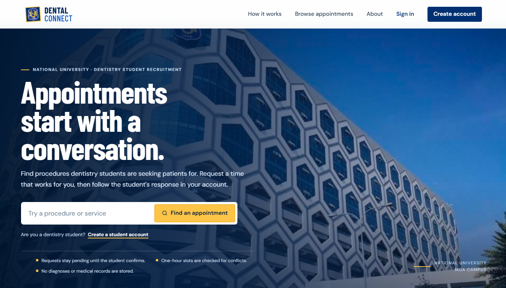

  

<h1>NU DentalConnect</h1>

Appointments start with a conversation.

  

  
  
  

[README](README.md) · [INSTALL](INSTALL.md) · [User guide](docs/USER_GUIDE.md) ·
[Architecture](docs/ARCHITECTURE.md) · [Database](docs/DATABASE.md) ·
[Security](docs/CYBERSECURITY.md) · [Reviewer guide](docs/REVIEWER_GUIDE.md) ·
[Design](docs/DESIGN.md)

> [!NOTE]
> This file covers the project at a glance and where to go next.
> It does not cover setup or implementation (see [INSTALL](INSTALL.md) and
> [Architecture](docs/ARCHITECTURE.md)).

## What it does

NU DentalConnect is a campus appointment-request site. Dentistry students post
procedure listings and patients can express interest with an application or ask
for an appointment time. The student confirms a request or proposes another
time. These are separate workflows.

| Role | What the site lets the role do |
| --- | --- |
| Patient | Browse published listings, apply, request appointments and view an approved student's profile. |
| Dentistry student | After email verification and administrator approval, publish listings, review applications and respond to appointment requests. |
| Administrator | Review student registrations, manage accounts, listings and appointments. |

## Trust principles

- Students must be verified by the admin beforehand.
- Appointment requests stay pending until the student confirms them.
- A patient application is separate from an appointment request.
- The application stores profile, appointment and scheduling data. It has no diagnoses or
  medical records.

## Get started

1. Follow [INSTALL](INSTALL.md) to prepare the local environment.
2. Start the app and open it in a browser.
3. Create an account and verify your email address.
4. **Full setup: see [INSTALL.md](INSTALL.md).**

## Documentation map

| File | Use it for |
| --- | --- |
| [README.md](README.md) | Product overview and documentation map. |
| [INSTALL.md](INSTALL.md) | Local database, configuration, startup and troubleshooting. |
| [docs/USER_GUIDE.md](docs/USER_GUIDE.md) | Patient, student and administrator task walkthroughs. |
| [docs/ARCHITECTURE.md](docs/ARCHITECTURE.md) | Application layers, request flow and implementation modules. |
| [docs/DATABASE.md](docs/DATABASE.md) | Tables, relationships, constraints and migration history. |
| [docs/CYBERSECURITY.md](docs/CYBERSECURITY.md) | Implemented safeguards, access rules and limitations. |
| [docs/REVIEWER_GUIDE.md](docs/REVIEWER_GUIDE.md) | Presentation script, feature crosswalk and reviewer questions. |
| [docs/DESIGN.md](docs/DESIGN.md) | Color, typography, motion and responsive behavior. |

## Team and credits

- Repository: https://github.com/jumong-code/nu-dentalconnect
- Student / Section: Cedric C. Soriano - BSIT-2B
- Professors: John Wilson Relova, John Wilmar Ludovice, Joshua Dela Rueda

## For reviewers

Start with the [reviewer guide](docs/REVIEWER_GUIDE.md), then use the
[user guide](docs/USER_GUIDE.md) for screen-by-screen paths.

---

[README](README.md) · [INSTALL](INSTALL.md) · [User guide](docs/USER_GUIDE.md) ·
[Architecture](docs/ARCHITECTURE.md) · [Database](docs/DATABASE.md) ·
[Security](docs/CYBERSECURITY.md) · [Reviewer guide](docs/REVIEWER_GUIDE.md) ·
[Design](docs/DESIGN.md)
