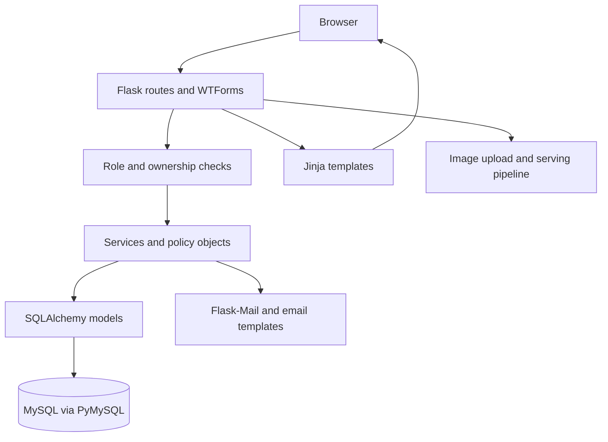
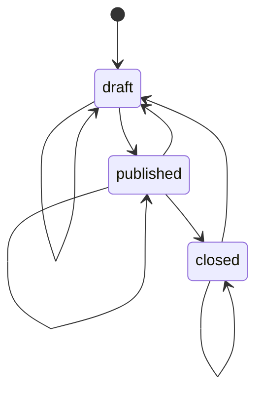

<div align="center">
  

<h1>Architecture</h1>

<p>How the Flask application is assembled</p>
</div>

[README](../README.md) · [INSTALL](../INSTALL.md) · [User guide](USER_GUIDE.md) ·
[Architecture](ARCHITECTURE.md) · [Database](DATABASE.md) · [Security](CYBERSECURITY.md) ·
[Reviewer guide](REVIEWER_GUIDE.md) · [Design](DESIGN.md)

> [!NOTE]
> This file covers runtime layers, classes and data flow.
> It does not cover installation or end-user tasks (see [INSTALL](../INSTALL.md)
> and [User guide](USER_GUIDE.md)).

## Runtime layers



`run.py` imports `create_app()` and exposes `app`. `app/__init__.py` configures
Flask extensions, template helpers, response headers, error pages, CLI commands
and the five blueprints. HTML is rendered server-side with Jinja. JavaScript in
`app/static/js/app.js` adds client-side form validation and interface behavior;
the server-side WTForms rules remain authoritative.

## Module map

| Area | Implementation |
| --- | --- |
| App and extensions | `app/__init__.py`, `app/extensions.py`, `run.py`, `config.py` |
| Persistent entities | `app/models.py` |
| Registration and role routes | `app/routes/auth.py`, `main.py`, `patient.py`, `student.py`, `admin.py` |
| Forms and normalization | `app/forms.py`, `app/formatters.py` |
| Student review lifecycle | `app/approval.py` — `StudentApprovalService` |
| Profile visibility | `app/profile_policy.py` — `ProfileAccessPolicy`, `AccessResult` |
| Event records and device context | `app/audit.py` — `AuditLogger`, `DeviceInfo` |
| OTP, email, notifications and scheduling | `app/services.py` |
| Image handling | `app/upload.py` |
| Wall-clock display | `app/time_utils.py` |
| Built-in listing presets | `app/listing_presets.py` |
| Pages and interaction | `app/templates/`, `app/static/css/app.css`, `app/static/js/app.js` |

## Object-oriented structure

- `models.py`: `User`, `Patient`, `DentistryStudent`, `RecruitmentListing`,
  `StudentListingTemplate`, `PatientApplication`, `Appointment`, `Notification`,
  `OTPVerification`, and `AuditLog` are SQLAlchemy model classes. `User`
  encapsulates password, approval and activation operations; `Appointment`
  provides `can_cancel()`.
- `approval.py`: `StudentApprovalService` centralizes pending, approval,
  rejection, queue selection and administrator notification behavior.
- `audit.py`: `DeviceInfo` parses and represents request device context;
  `AuditLogger` exposes single-purpose event methods over `AuditLog`.
- `profile_policy.py`: `AccessResult` is the policy outcome enum;
  `ProfileAccessPolicy` evaluates profile authorization and visible fields.
- `formatters.py`: `FieldFormatter` normalizes year, campus and name fields.
- `services.py`: workflow functions implement email, OTP, notification and
  scheduling operations; this module has no service class.

## Request and student approval flow

```mermaid
sequenceDiagram
    actor Student
    participant Auth as auth routes
    participant OTP as OTP service
    participant DB as MySQL
    participant Admin as admin routes
    Student->>Auth: Register student
    Auth->>DB: Create pending student and profile
    Auth->>OTP: Issue six-digit email code
    Student->>Auth: Submit code
    Auth->>DB: Mark email verified; keep approval pending
    Auth-->>Student: Show approval wait page
    Admin->>Admin: Open Pending Students
    Admin->>DB: Approve or deactivate student
    Admin-->>Student: In-app notice and email attempt
```

The login and user-loader checks both require active, email-verified and
approved accounts. `StudentApprovalService` notifies active administrators
after student email verification.

## Status transitions



The routes permit only the listed listing transitions. Appointment statuses
are `pending`, `confirmed`, `reschedule_requested`, `completed`, `cancelled`,
and `rejected`; route actions govern transitions rather than a dedicated state
service. A request can be confirmed or rejected by the student; either party can
propose a time through a reschedule request; a patient may accept the proposal;
an eligible past confirmed appointment can be completed. Cancellation is
available for upcoming appointments. See the exact route guards in
`app/routes/patient.py` and `app/routes/student.py`.

```mermaid
stateDiagram-v2
    [*] --> pending
    pending --> confirmed: student confirms
    pending --> rejected: student rejects
    pending --> reschedule_requested: either party proposes
    pending --> cancelled: upcoming; patient or student cancels
    confirmed --> reschedule_requested: either party proposes
    confirmed --> cancelled: upcoming; patient or student cancels
    confirmed --> completed: student marks past appointment complete
    reschedule_requested --> confirmed: student confirms or patient accepts
    reschedule_requested --> rejected: student rejects
    reschedule_requested --> reschedule_requested: another proposal
    reschedule_requested --> cancelled: upcoming; patient or student cancels
    rejected --> [*]
    cancelled --> [*]
    completed --> [*]
```



## Time and timezone

`utcnow()` stores naive UTC `datetime` values in the database. User-entered
`datetime-local` values are interpreted as Manila wall time (fixed UTC+08:00 in
`app/time_utils.py`) and converted to naive UTC before persistence. The
`local_datetime` template filter converts stored values back to Manila time.
Audit date filters use Manila calendar days and convert their boundaries to
UTC.

## Upload pipeline

`upload.py` checks file size and decodes image content with Pillow, accepts
JPEG/PNG/WebP, enforces a 50-megapixel ceiling, resizes avatars to 512px and
listing covers to 1600px, re-encodes to a UUID filename, and stores files under
`instance/uploads/{avatars,covers}` outside `static/`. Serving routes require
sign-in and apply profile/listing visibility checks. The application-wide
request body limit is 5 MiB.

## Email rendering pipeline

`services.send_email()` returns false when SMTP host or username is missing.
Otherwise it supplies Manila-local template time and authorization text, renders
`app/templates/emails/<name>.html` and, when available, the matching `.txt`
variant, then sends via Flask-Mail. OTP messages use `otp`; notices and approval
messages use `notice`; password reset uses `reset`. In development, an OTP is
also logged if SMTP is absent.

---

[README](../README.md) · [INSTALL](../INSTALL.md) · [User guide](USER_GUIDE.md) ·
[Architecture](ARCHITECTURE.md) · [Database](DATABASE.md) · [Security](CYBERSECURITY.md) ·
[Reviewer guide](REVIEWER_GUIDE.md) · [Design](DESIGN.md)