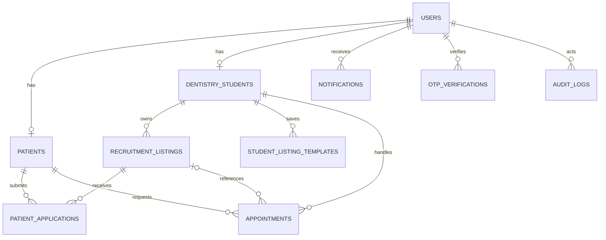

<div align="center">
  

<h1>Database reference</h1>

<p>Schema and relationships in the current models</p>
</div>

[README](../README.md) · [INSTALL](../INSTALL.md) · [User guide](USER_GUIDE.md) ·
[Architecture](ARCHITECTURE.md) · [Database](DATABASE.md) · [Security](SECURITY.md) ·
[Reviewer guide](REVIEWER_GUIDE.md) · [Design](DESIGN.md)

> [!NOTE]
> This file covers tables, columns, relationships and migration history.
> It does not cover environment setup or authorization policy (see [INSTALL](../INSTALL.md)
> and [Security](SECURITY.md)).

## Entity relationship diagram



## Table reference

All columns below are from `app/models.py`; timestamps are naive UTC values.
`PK`, `FK`, `UQ` and `NN` mean primary key, foreign key, unique and not-null.

### `users`

- `id` PK; `full_name` NN; `email` NN, unique and indexed; `password_hash` NN.
- `role` enum(patient/student/admin) NN; `phone`; `is_active` NN;
  `email_verified` NN.
- `approval_status` varchar NN; `auth_version` NN; `created_at` NN.

### `patients`

- `id` PK; `user_id` FK to users, unique and NN; `avatar_image`.

### `dentistry_students`

- `id` PK; `user_id` FK to users, unique and NN; `year_level`; `bio`; `campus`;
  `facebook_url`; `avatar_image`.

### `recruitment_listings`

- `id` PK; `student_id` FK to dentistry_students, NN and indexed.
- `title` NN; `description` NN; `category` NN and indexed; `location` NN;
  `preferred_schedule` NN; `eligibility` NN.
- `status` enum(draft/published/closed), NN and indexed; `submission_key` unique;
  `cover_image`; `created_at` NN.

### `student_listing_templates`

- `id` PK; `student_id` FK to dentistry_students, NN and indexed.
- `name`, `title`, `category`, `location`, `preferred_schedule`,
  `description`, and `eligibility` are NN; `created_at` NN.

### `patient_applications`

- `id` PK; `listing_id` FK to recruitment_listings, NN and indexed.
- `patient_id` FK to patients, NN and indexed; `message`;
  `status` enum(pending/accepted/rejected/withdrawn), NN; `created_at` NN.
- Unique pair: (`listing_id`, `patient_id`).

### `appointments`

- `id` PK; `patient_id` FK to patients, NN and indexed; `student_id` FK to
  dentistry_students, NN and indexed; `listing_id` FK to listings, nullable.
- `starts_at` NN and indexed; `location` NN; `note`;
  `status` enum NN and indexed; `proposed_at`; `created_at` NN.
- Status values: pending, confirmed, reschedule_requested, completed,
  cancelled and rejected.

### `notifications`

- `id` PK; `user_id` FK to users, NN and indexed; `message` NN;
  `created_at` NN; `read_at`.

### `otp_verifications`

- `id` PK; `user_id` FK to users, NN and indexed; `code_digest` NN;
  `created_at` NN and indexed; `expires_at` NN and indexed; `consumed_at`;
  `attempts` smallint NN.
- Composite index on (`user_id`, `created_at`).

### `audit_logs`

- `id` PK; `actor_user_id` FK to users, indexed and nullable; `actor_email` NN;
  `action` NN and indexed; `entity_type` NN; `entity_id`.
- `details` JSON NN; `ip_address`; `user_agent`; `created_at` NN and indexed.
- Composite index on (`created_at`, `id`).

The schema has no diagnosis or medical-record table. `AuditLog.details` is a
JSON document whose keys vary by event.

## Constraints and deletion behavior

- User email is unique. Each patient/student profile has a unique `user_id`.
- An application is unique per patient and listing.
- Deleting a user cascades to its patient/student profile, notifications and
  OTP rows through configured relationships/foreign keys.
- Deleting a student profile cascades to owned listings and saved templates;
  deleting a listing cascades to applications.
- Appointment `listing_id` uses `ON DELETE SET NULL`; patient or student
  ownership uses `ON DELETE CASCADE`.
- Audit actor deletion uses `ON DELETE SET NULL`; `actor_email` remains a
  snapshot.
- Additional business rules (time conflicts, account states and allowed status
  changes) are enforced in Python routes/services, not SQL check constraints.

## Migration chain

Read from files, not executed. `flask db heads` was not run because app startup
loads the configured database URL and could inspect the real database.

```text
a5fd38a6e1d2  initial schema
  -> 1e0c92bb72f1  student listing templates
  -> 7c2e0a4b6f11  security audit, OTP, profile
  -> 49247ed3d1b4  avatar and cover image columns
  -> 6848c391232f  student approval status
```

Each arrow is verified from `revision` and `down_revision` in
`migrations/versions/`. The current head inferred from those files is
`6848c391232f`.

---

[README](../README.md) · [INSTALL](../INSTALL.md) · [User guide](USER_GUIDE.md) ·
[Architecture](ARCHITECTURE.md) · [Database](DATABASE.md) · [Security](SECURITY.md) ·
[Reviewer guide](REVIEWER_GUIDE.md) · [Design](DESIGN.md)